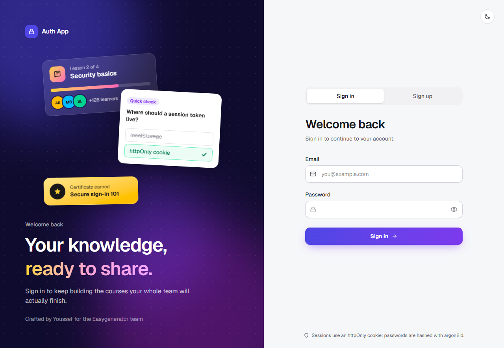
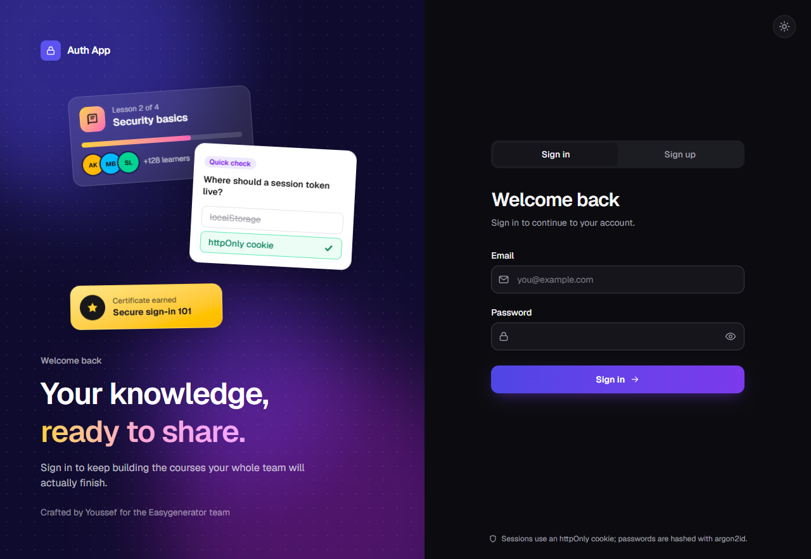
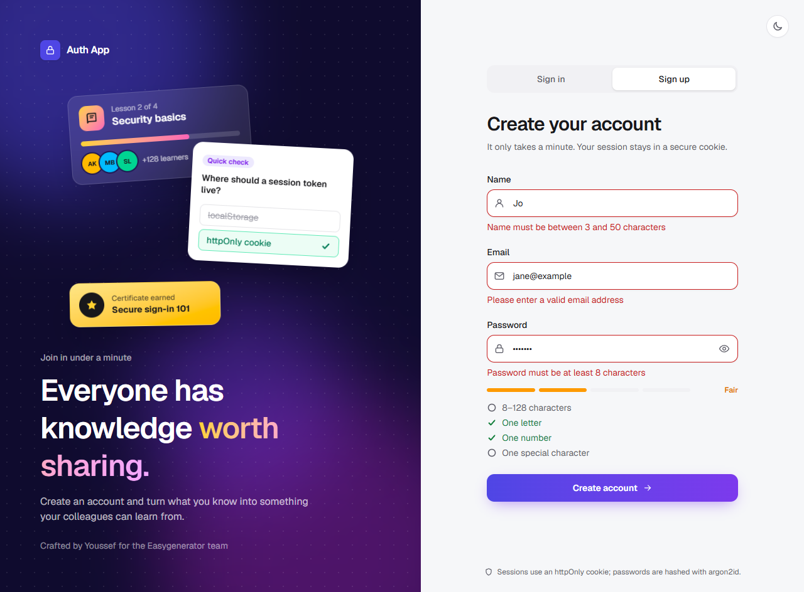
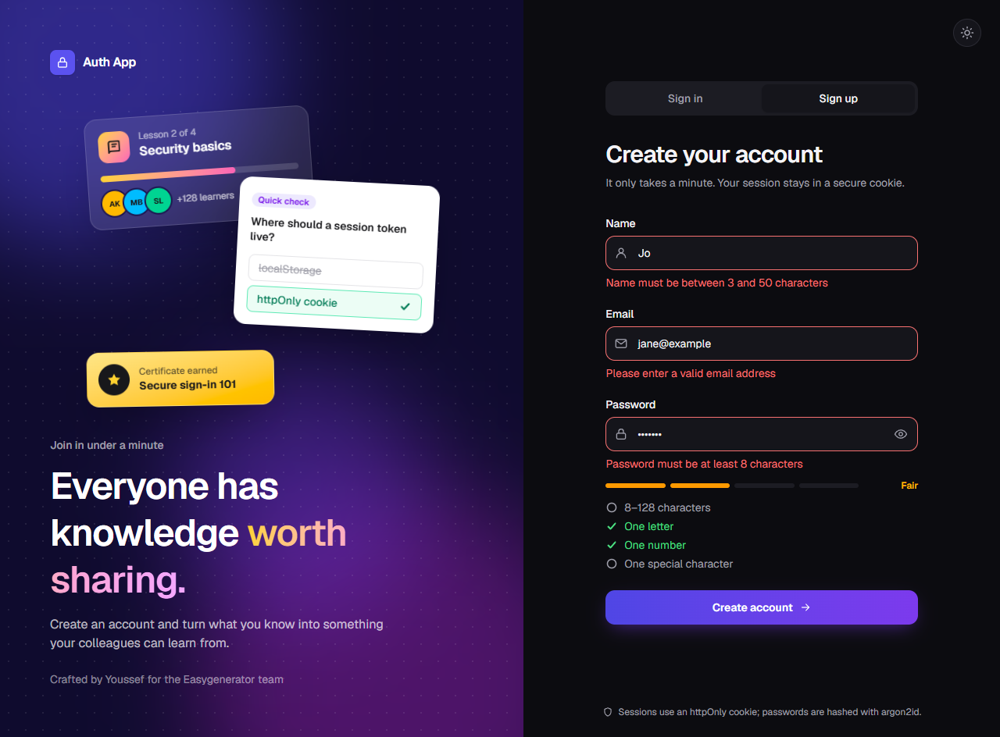
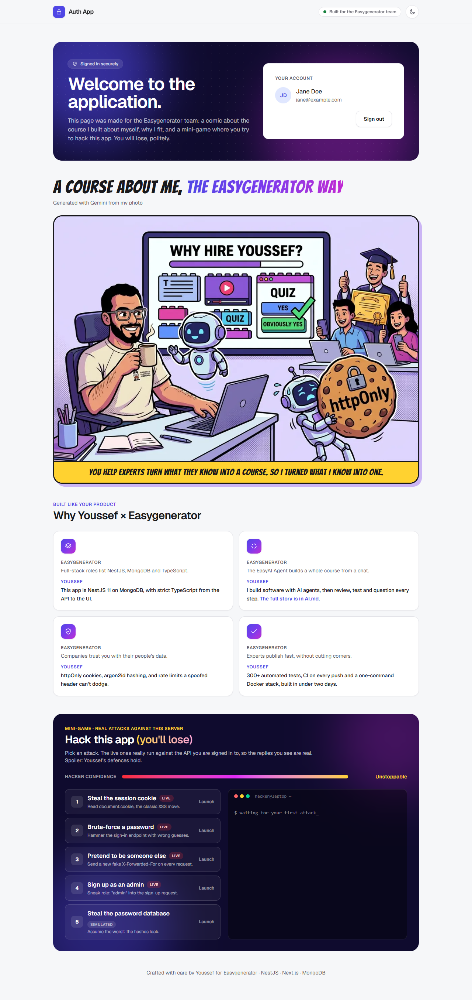
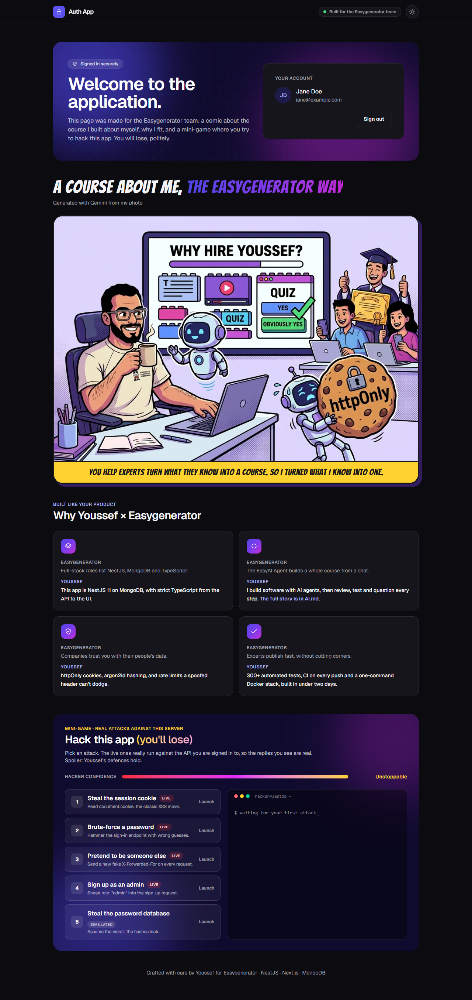
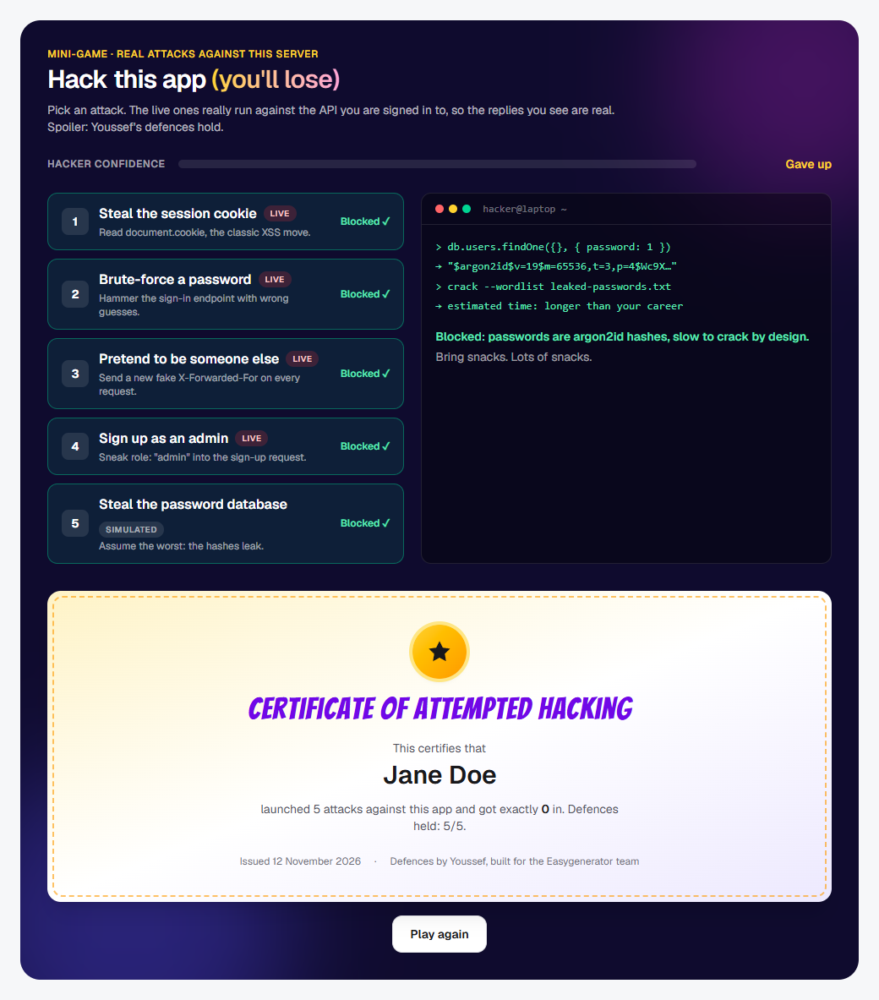
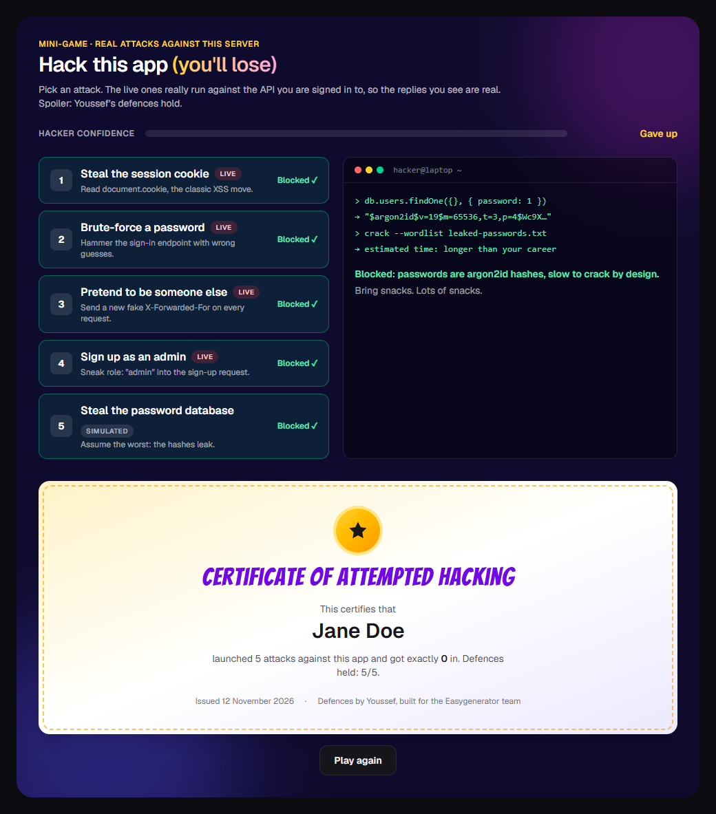
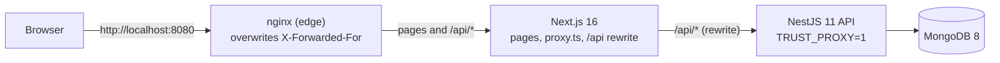

# Auth Fullstack Task

A production-ready sign-up / sign-in module: a **NestJS 11** API with MongoDB and a
**Next.js 16** frontend. Sessions are a JWT in an `httpOnly` cookie, so no token is ever
readable by JavaScript. Everything runs behind one origin with `docker compose up`.

> **For reviewers**
> - **Run:** `echo "JWT_SECRET=$(openssl rand -hex 48)" > .env && docker compose up --build -d --wait` (bash; PowerShell [below](#quick-start-docker))
> - **Open:** http://localhost:8080 (API docs: http://localhost:8080/api/docs)
> - **Test** (from the repo root): `(cd backend && npm ci && npm test && npm run test:e2e)` and `(cd frontend && npm ci && npm test)`
> - **Auth logic:** [`auth.service.ts`](backend/src/modules/auth/auth.service.ts), [`jwt.strategy.ts`](backend/src/modules/auth/jwt.strategy.ts), [`auth-cookie.service.ts`](backend/src/modules/auth/auth-cookie.service.ts), [`proxy.ts`](frontend/src/proxy.ts), [`auth.store.ts`](frontend/src/features/auth/store/auth.store.ts), [`(protected)/layout.tsx`](<frontend/src/app/(protected)/layout.tsx>)
> - **How AI was used:** [AI.md](AI.md)

| | Light | Dark |
|---|---|---|
| Sign in |  |  |
| Sign up (validation) |  |  |
| App (comic, why me, game) |  |  |
| "Hack this app" game, finished |  |  |

The sign-in and sign-up pages pair the form with an animated brand panel. After sign-in, the page made
for the Easygenerator team shows a comic generated with Gemini from my photo ("Why hire Youssef?", built
like an Easygenerator course), four of Easygenerator's priorities matched with evidence from this app, and
a mini-game: five attacks, four of them live against this API (reading `document.cookie`, brute force,
rotating `X-Forwarded-For`, signing up with `role: "admin"`), all blocked, ending in a certificate of
attempted hacking.
360px mobile versions are in [`frontend/docs/screenshots`](frontend/docs/screenshots).

**Contents:** [Architecture](#architecture) · [Tech stack](#tech-stack) · [Repository structure](#repository-structure) · [Quick start](#quick-start-docker) · [Local development](#local-development-without-docker) · [Environment variables](#environment-variables) · [API](#api) · [Testing](#testing) · [CI](#ci) · [Security decisions](#security-decisions) · [Known limitations](#known-limitations--trade-offs) · [Troubleshooting](#troubleshooting) · [AI usage](#ai-usage)

## Architecture



**Why same-origin.** The browser only talks to one origin: Next.js rewrites `/api/*` to the
API. The auth cookie is first-party (`SameSite=Lax` works, no third-party-cookie blocking, no
credentialed CORS), `proxy.ts` can see the cookie for redirects, and the API, Next.js and
MongoDB are never published to the host. In Docker only nginx (8080) is.

**Request flow.** `proxy.ts` makes an optimistic redirect from the cookie's presence only. The
`(protected)` layout then confirms the session with `GET /api/users/me`. A cookie the API
rejects is cleared via `POST /api/auth/logout` and the user lands on `/signin`.

## Tech stack

| Area | Choice (version) | Why |
|---|---|---|
| API | NestJS 11.2, TypeScript 5.9 strict | Modules, DI, guards and pipes keep auth concerns separated |
| Database | MongoDB 8 via Mongoose 9.12 | Unique email index, `select: false` for the hash |
| Passwords | argon2 0.44 (argon2id) | Memory-hard hashing; 0.44 pinned (0.45.2 segfaults on Windows) |
| Auth | @nestjs/jwt 11 + passport-jwt 4, HS256 | Stateless JWT read from the `access_token` cookie |
| Hardening | helmet 8, @nestjs/throttler 6.7, Joi 18 env validation | Headers, per-IP rate limits, fail-fast config |
| Logging / docs | nestjs-pino 5 (pino 10), @nestjs/swagger 11.4 | JSON logs with redacted cookies; OpenAPI at `/api/docs` |
| Frontend | Next.js 16.4 (App Router), React 19.3 | `proxy.ts` route protection, rewrites, standalone server |
| Forms / state | react-hook-form 7.92 + Zod 4.6, Zustand 5.1, axios 1.21 | Same rules as the API; tiny store without persistence |
| UI | Tailwind CSS 4.3, next/image | Light/dark tokens that follow the system until the sun/moon toggle picks one (kept in localStorage as a display preference, applied before first paint); CSS animations (off with reduced motion); no UI or animation library |
| Tests | Jest 30 + supertest + mongodb-memory-server; Vitest 4.1 + Testing Library + MSW 2 | Real HTTP and in-memory MongoDB for the API; jsdom + mocked network for the UI |
| Delivery | Docker (Node 22 alpine), nginx 1.30, GitHub Actions | Production-like stack in one command |

Node: Docker and CI use **Node 22 LTS** (`.nvmrc`); `engines` is `>=20.19.0`, so Node 20 still works locally.

## Repository structure

```
.
├─ backend/                 NestJS API
│  ├─ src/common/           constants (shared validation rules), decorators, filters, guards
│  ├─ src/config/           env validation, app bootstrap, logger, swagger, trust proxy
│  ├─ src/modules/          auth, users (schema + DTOs), health
│  ├─ test/                 e2e specs + utils (in-memory MongoDB, test app factory)
│  └─ Dockerfile
├─ frontend/                Next.js app
│  ├─ src/app/              (auth)/signin, (auth)/signup, (protected)/app, not-found, error;
│  │                        route-only components in _components/ (showcase, comic, game)
│  ├─ src/components/ui/    Button, Input, Label, FormField, Card, Alert, Spinner, Logo
│  ├─ src/features/auth/    components, schemas, services, store, types
│  ├─ src/lib/              http client, ApiError, form error helper, routes (no feature imports)
│  ├─ src/proxy.ts          optimistic route protection
│  ├─ public/images/        the AI-generated comic
│  ├─ docs/screenshots/
│  └─ Dockerfile
├─ nginx/nginx.conf         edge proxy (only published service)
├─ docker-compose.yml
├─ .env.example             compose secrets (JWT_SECRET)
└─ .github/workflows/ci.yml
```

## Quick start (Docker)

```bash
echo "JWT_SECRET=$(openssl rand -hex 48)" > .env   # or copy .env.example and fill it in
docker compose up --build -d --wait               # first build takes a few minutes
# open http://localhost:8080  (API docs: http://localhost:8080/api/docs)
```

In **Windows PowerShell 5.1**, `>` writes UTF-16, which compose cannot read. Use Git Bash, or:

```powershell
"JWT_SECRET=$(node -e "console.log(require('crypto').randomBytes(48).toString('hex'))")" | Set-Content -Encoding ascii .env
docker compose up --build -d --wait
```

`docker compose down` stops the stack; add `-v` to also delete the MongoDB volume. Use exactly
`http://localhost:8080`: the cookie is `Secure` in this stack ([why](#troubleshooting)).

## Local development (without Docker)

Requirements: Node 22 (or ≥ 20.19) and MongoDB listening on `127.0.0.1:27017`. Use two terminals,
each starting at the repository root.

**Terminal 1: API** on http://localhost:4000/api (docs: `/api/docs`)

```bash
cd backend
cp .env.example .env        # then set JWT_SECRET (the generator command is in the file)
npm ci
npm run start:dev
```

**Terminal 2: web** on http://localhost:3000 (proxies `/api` to `BACKEND_URL`)

```bash
cd frontend
cp .env.example .env.local
npm ci
npm run dev
```

## Environment variables

**Backend** (`backend/.env`, validated with Joi at startup; the app refuses to start on invalid values)

| Variable | Required | Default | Purpose |
|---|---|---|---|
| `NODE_ENV` | no | `development` | `development`, `production` or `test`; production adds `Secure` to the cookie and logs JSON |
| `PORT` | no | `4000` | HTTP port |
| `MONGODB_URI` | yes | — | `mongodb://` or `mongodb+srv://` URI |
| `JWT_SECRET` | yes | — | HS256 secret, at least 32 characters |
| `JWT_EXPIRES_IN` | no | `1d` | Token lifetime (`15m`, `1h`, `1d`…); also the cookie `Max-Age` |
| `CORS_ORIGIN` | yes | — | Origin allowed to make credentialed requests |
| `THROTTLE_TTL_MS` | no | `60000` | Rate-limit window |
| `THROTTLE_LIMIT` | no | `5` | Sign-in / sign-up attempts per window per client IP (`.env.example` uses 20 for local dev) |
| `TRUST_PROXY` | no | `false` | Which proxies may set `X-Forwarded-For`: `false`, `loopback`, a hop count, or IPs/CIDRs ([details](#rate-limiting-and-trust_proxy)) |

**Frontend** (`frontend/.env.local`)

| Variable | Required | Purpose |
|---|---|---|
| `BACKEND_URL` | yes | API origin for the `/api/*` rewrite (e.g. `http://localhost:4000`). Read by `next dev`, `next build` and `npm run typecheck`; compiled into the build (a Docker **build arg**). |

**Root** (`.env`, used by `docker compose`)

| Variable | Required | Purpose |
|---|---|---|
| `JWT_SECRET` | yes | Passed to the API; compose refuses to start without it |
| `JWT_EXPIRES_IN` | no | Session length, default `1d` |

## API

Base path `/api`. Interactive docs (Swagger, cookie auth): **`/api/docs`**. OpenAPI JSON: `/api/docs-json`.

| Method | Path | Auth | Success | Errors |
|---|---|---|---|---|
| `POST` | `/api/auth/signup` | — (rate limited) | `201` user + `access_token` cookie | `400`, `409`, `429` |
| `POST` | `/api/auth/signin` | — (rate limited) | `200` user + `access_token` cookie | `400`, `401`, `429` |
| `POST` | `/api/auth/logout` | — | `204`, cookie cleared | — |
| `GET` | `/api/users/me` | cookie | `200` user | `401` |
| `GET` | `/api/health` | — | `200` `{ status, database, uptime, timestamp }` | `503` when MongoDB is down |

The user is always `{ id, email, name, createdAt }`. Every error has the same shape:
`{ statusCode, message, error, path, timestamp }`, where `message` is a list for validation errors.

## Testing

| | Command | What it covers |
|---|---|---|
| Backend unit | `cd backend && npm test` (`npm run test:cov`) | Services, the exception filter, DTO validation, config parsing (env, durations, `TRUST_PROXY`), cookie options |
| Backend e2e | `npm run test:e2e` (`npm run test:e2e:cov`) | The real app bootstrap against in-memory MongoDB: full session flow, validation messages (including emoji names), duplicate emails, identical 401s, cookie attributes (incl. `Secure` in production), a JWT that carries only `sub`, tampered/expired/foreign/`alg=none` JWTs, deleted users, 429 + `Retry-After`, `TRUST_PROXY` behaviour (including a rotating `X-Forwarded-For`), 413 for oversized bodies, health/Swagger, and that no response ever contains a password or hash |
| Frontend | `cd frontend && npm test` (`npm run test:cov`, `test:watch`) | Zod schemas, HTTP error normalization, message-to-field mapping, store, forms (MSW), strength meter, `proxy.ts`, protected layout, the auth switch and showcase, the comic section and the hack-this-app game |

Coverage at the time of writing: backend e2e **96% statements** (unit 50%, since controllers and wiring are
exercised end to end); frontend **91% statements / 89% branches**. The backend's first `npm ci` also
downloads a MongoDB binary for the in-memory e2e database (several hundred MB), so it can take a while.

**Drift guard.** The validation **constants are shared and drift-guarded; the logic is mirrored and tested
on both sides**. Rules and messages live in `backend/src/common/constants/validation.constants.ts`; the
frontend keeps an identical copy, and `validation.constants.test.ts` imports the backend file by relative
path and deep-compares every export (regexes by source and flags). The checks themselves exist twice
(class-validator DTOs and Zod schemas) and each side has its own tests, including the same edge cases.

## CI

`.github/workflows/ci.yml` runs on every push and pull request (read-only permissions, superseded runs cancelled):

1. **backend**: `npm ci`, lint, typecheck, unit, e2e (MongoDB binaries cached), build.
2. **frontend**: `npm ci`, lint, typecheck, format check, tests, build.
3. **docker** (after both): `docker compose build`, `up --wait` with a generated secret, then smoke-test
   `/api/health` and sign-up → `/api/users/me` through nginx on port 8080.

## Security decisions

- **Passwords**: argon2id; the hash is `select: false` in the schema and responses are built from an
  allow-list DTO, so the hash cannot be serialized. Inputs are whitelisted (`forbidNonWhitelisted`), so
  extra fields such as `role` are rejected.
- **Session cookie**: `access_token`, `HttpOnly`, `SameSite=Lax`, `Path=/`, `Max-Age` = JWT lifetime, and
  `Secure` when `NODE_ENV=production`. JWTs are pinned to HS256, carry only the user id (`sub`), and the
  user must still exist.
- **No tokens in client state**: the Zustand store holds only `{ id, email, name }` and a status. Nothing is
  persisted, and nothing touches `localStorage`.
- **Generic auth errors**: sign-in always answers `401 Invalid email or password`. Unknown emails are verified
  against a dummy argon2 hash, so the response time does not reveal whether an account exists.
- **Rate limiting**: 5 sign-in and 5 sign-up attempts per minute per client IP, with 429 + `Retry-After`.
  A client cannot change its bucket by sending `X-Forwarded-For` ([details](#rate-limiting-and-trust_proxy)).
- **Headers**: helmet on the API; `X-Frame-Options: DENY`, `nosniff`, `Referrer-Policy` and
  `Permissions-Policy` on pages; `X-Powered-By` and nginx versions hidden.
- **Configuration**: all settings come from the environment and are validated at startup (Joi for the API,
  Zod for `BACKEND_URL`). Secrets are only in git-ignored `.env` files, and logs redact cookies and
  `Authorization` headers.
- **Containers**: multi-stage images with production dependencies only; nginx, Next.js, the API and
  MongoDB all run as non-root users; only port 8080 is published, and each service pair has its own network.

### Rate limiting and TRUST_PROXY

<details>
<summary>Why local dev uses <code>TRUST_PROXY=false</code> and Docker uses <code>1</code></summary>

The Next.js `/api` rewrite adds no `X-Forwarded-For` and forwards a client-sent one unchanged.

- **Local development** uses `TRUST_PROXY=false` (also the default when unset): the header is ignored and
  every browser shares the Next.js server's address, i.e. one bucket. That is strict, but it cannot be
  bypassed; `backend/.env.example` raises the limit to 20 for this reason.
- **Docker**: nginx **overwrites** `X-Forwarded-For` with the client address (never appends), and the API
  trusts exactly one hop (`TRUST_PROXY=1`, the Next.js server). A spoofed header never changes the bucket.
  This is tested in e2e (including a rotating header) and was verified through the running stack.
- **Other deployments**: put a reverse proxy in front that overwrites the header, keep Next.js and the API
  reachable only through it, and trust only the hops between that proxy and the API.

</details>

## Known limitations / trade-offs

- **Sign-up reveals registered emails** (`409 Email already registered`): a deliberate UX trade-off, so
  users learn they already have an account. Sign-in does not leak this.
- **Logout does not revoke the JWT**: it clears the cookie, but a copied token stays valid until it expires
  (`JWT_EXPIRES_IN`, 1 day by default). Revocation would need a denylist or short tokens with refresh.
- **The throttler stores counters in memory**: limits apply per API instance and reset on restart. Several
  instances would need a shared store (e.g. Redis).
- **Local development shares one rate-limit bucket** (`TRUST_PROXY=false` behind the Next.js rewrite).
- **The frontend email check differs slightly from the backend's, in both directions**: Zod rejects rare
  RFC-valid characters such as `!` in the local part, and accepts a 65-character local part or a
  64-character domain label that validator.js rejects. The API remains the authority, and its 400 is shown
  on the email field.
- **Swagger is served in the Docker stack** (`/api/docs`): useful for this demo; a real production
  deployment would disable it or put it behind authentication.
- **Pages have no Content-Security-Policy** (the API sends helmet's). A real production deployment would add
  a nonce-based CSP for the Next.js pages.
- **Out of scope**: refresh tokens, email verification and roles. There is no CSRF token, because
  `SameSite=Lax` plus a same-origin API covers this deployment; a cross-site deployment would need one.
- **MongoDB runs without authentication** on the private compose network (never published). Enable auth
  and TLS for real deployments.

## Troubleshooting

- **Signed in, but sent straight back to `/signin` (Docker).** Open the stack as exactly
  `http://localhost:8080`. The cookie is `Secure` (`NODE_ENV=production`), which browsers accept over plain
  HTTP only on `localhost`; any other host (a LAN IP, a VM, a domain) needs TLS.
- **Vitest: "failed to find the current suite" on Windows Git Bash.** Git Bash reports the drive letter in
  lowercase (`d:\…`) and Vitest then loads itself twice. Run the tests from PowerShell or cmd, or `cd /D/...`
  with an uppercase drive in Git Bash.
- **`BACKEND_URL` errors from `npm run typecheck` or `npm run build`.** `next typegen` and `next build`
  evaluate the rewrites, so create `frontend/.env.local` (or export `BACKEND_URL`) first.
- **`npm run start` warns about `output: standalone`.** The local production server still works; the Docker
  image runs `node server.js` from the standalone output instead.
- **Port 8080 already in use.** Stop the other service or change the published port in `docker-compose.yml`.
- **MongoDB exits with "Linux kernel versions 6.19 and newer has a known incompatibility".** `mongo:8.0`
  (8.0.34) and `mongo:9.0` refuse to start on kernel 6.19+ ([SERVER-121912](https://jira.mongodb.org/browse/SERVER-121912)).
  Compose pins `mongo:8.2`, which starts there (verified on GitHub's runners).

## AI usage

How AI assistance was used while building this project is documented in [AI.md](AI.md).
